<div align="center">


# WatchVerse

**A movie & TV tracker built around the questions you actually ask on the couch.**<br/>
*What fits in the time we have? What do we both want to see? What happened last episode?*

[](https://github.com/hasanhazirbulan/watch_verse/actions/workflows/ci.yml)


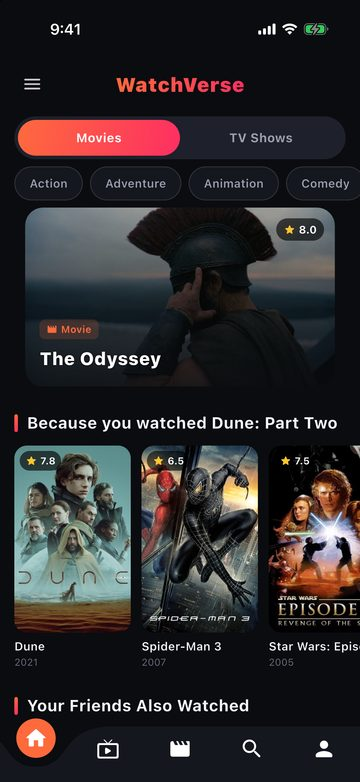
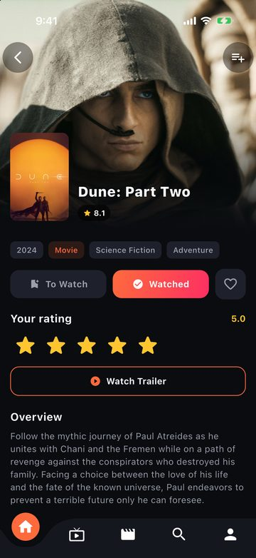
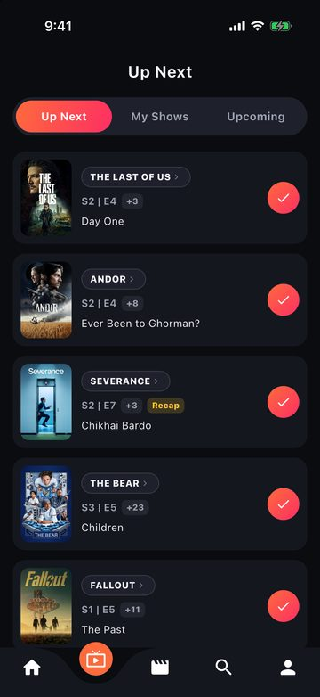
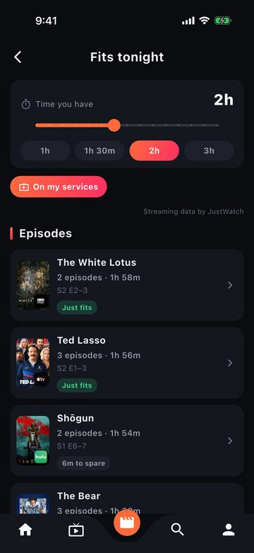
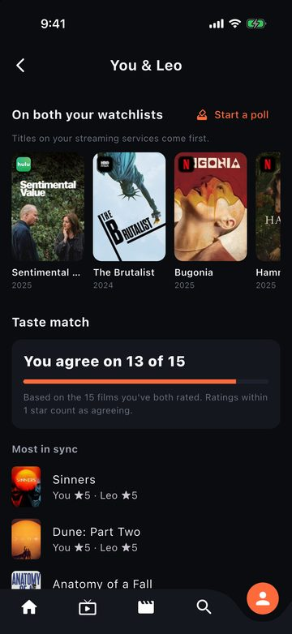

</div>

---

## What makes it different

Most trackers are a watchlist plus a log. WatchVerse uses that data to help you decide what to watch.

| | |
|---|---|
|  | **⏱ Fits tonight**<br/>Pick a time budget (30 min – 4 h) and get the movies on your watchlist that fit, plus runs of the next unwatched episodes of your shows ("3 episodes · 2h 10m"), closest fit first. Optionally only what's on your streaming services. *Watchlist → timer icon.* |
|  | **🤝 Common ground**<br/>On a friend's profile: the titles on *both* your watchlists (your services first), how often your ratings agree ("You agree on 13 of 15"), your closest matches and biggest splits, and one tap to start a "What should we watch?" poll with the shared titles. |
| 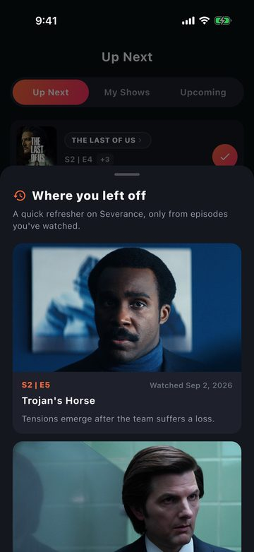 | **⏪ Where you left off**<br/>Shows you haven't touched for 30+ days get a *Recap* chip in Up Next: stills, synopses and watch dates of the last episodes **you** watched, and the cast from your latest episode. Spoiler-safe by construction: it never shows anything from an unwatched episode. |
| 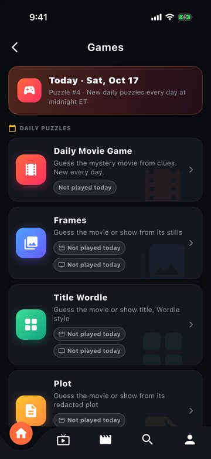 | **🎮 Games hub**<br/>Six free movie & TV games: Daily Movie, Frames, Title Wordle, Plot, Who's the Actor? and Higher or Lower. Daily puzzles, per-game status, and **no streaks**, so you can skip a day without being penalized. |
| 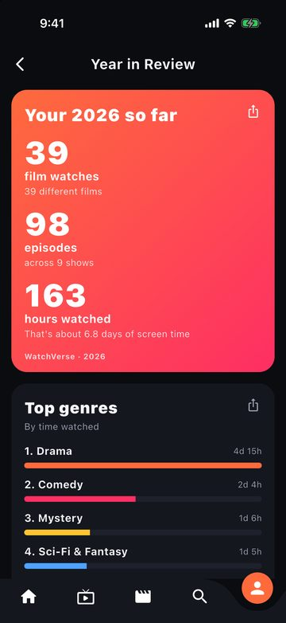 | **✨ Year in Review**<br/>A yearly recap built only from dated data: films, episodes, hours, top genres, busiest month, highest-rated films. Every card can be shared as an image. |

### Made for every screen

WatchVerse is built with the iOS 27.1 SDK and uses the full display on **iPhone Duo**, both folded and unfolded, as well as on iPad and in landscape. Grids gain columns, lists split into 2–3 columns and reading screens stay at a comfortable width. On regular iPhones the layout is unchanged (checked pixel for pixel against the previous version), and 180 layout tests cover five window sizes.

<p align="center">
  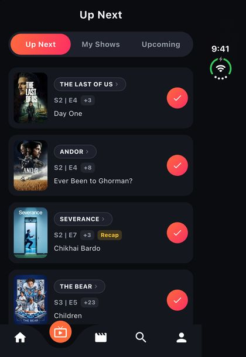
  &nbsp;
  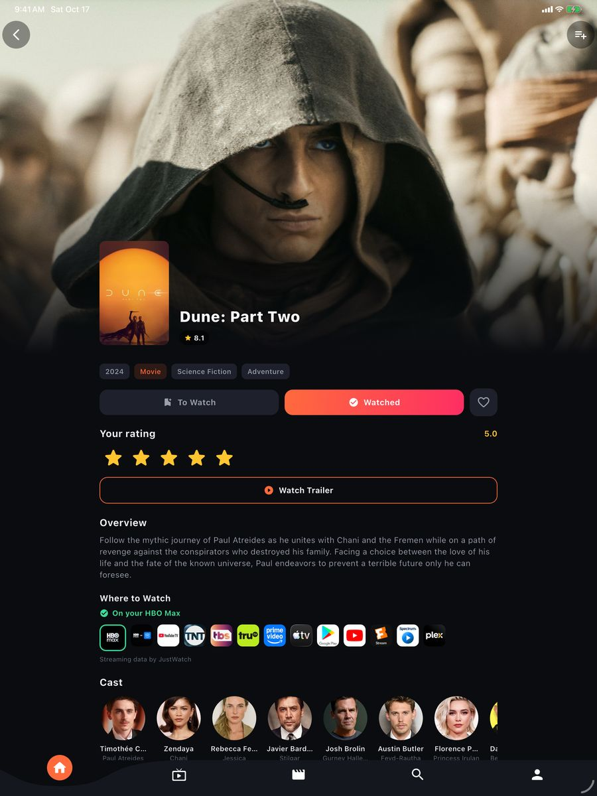
</p>

## Everything else

- **Discover**: trending, now playing, upcoming, popular and top-rated movies and shows; "Because you watched…" rows; search across movies, shows and people
- **Track**: watchlist, watched/ratings/favorites, a dated diary with rewatches and notes, per-episode tracking with Up Next / My Shows / Upcoming
- **Lists**: custom lists, public lists you can follow
- **Where to watch**: pick your region and services; "On my services" filters and badges (data by JustWatch via TMDB)
- **Social**: follow friends, activity feed, public profiles, comments with GIFs, post-watch polls, group watch polls; blocking and reporting
- **Stats**: time watched, movies vs. shows, genre and weekday charts
- **Import & export**: Letterboxd (zip/CSV) and IMDb (CSV) import; free CSV export of everything
- **Push notifications**: episodes airing, watchlist releases, a friend-activity digest and shared-watch matches
- **WatchVerse Pro / Patron**: optional StoreKit 2 subscriptions (unlimited lists, advanced stats; Patron adds profile themes and a badge). Entitlements are re-checked against the transaction history, so expired or refunded plans are removed
- **Privacy**: account deletion in the app, guest mode, and a [privacy policy](https://watchvers.web.app/privacy-policy.html) that's kept in sync with what the code actually stores

## Architecture

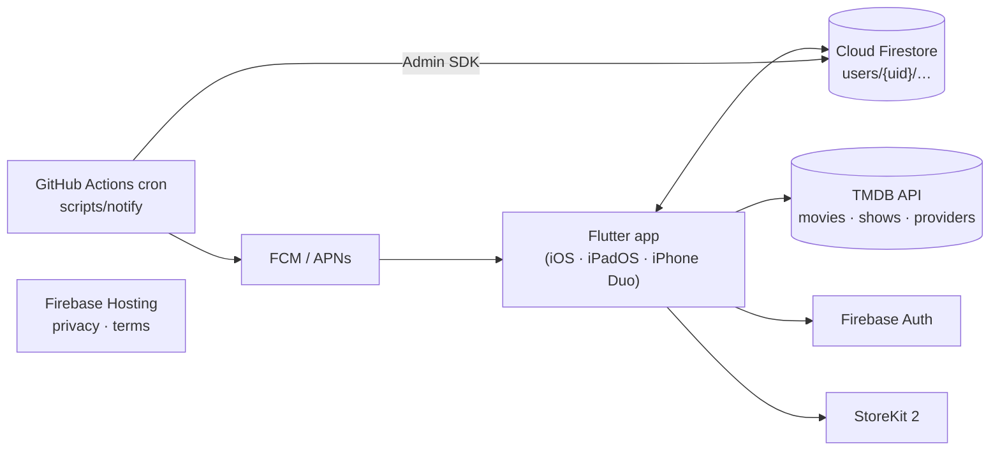

- **No backend of its own.** Everything runs on Firebase's free **Spark** plan: Auth, Firestore (guarded by [`firestore.rules`](firestore.rules), with an emulator test suite) and Hosting. There is no Cloud Storage and there are no deployed Cloud Functions.
- **Pushes without Cloud Functions.** [`scripts/notify/run.js`](scripts/notify/run.js) runs on a [GitHub Actions schedule](.github/workflows/notifications.yml) with the Admin SDK and resumes from a cursor, so a skipped run loses nothing. `functions/` holds the original Cloud Functions, kept for reference and **not** deployed.
- **Profile photos without Storage.** They're small inline images on `users/{uid}`.
- **Logic is kept apart from widgets.** Features like Fits tonight, Common ground, the recap, Year in Review and subscription entitlements have their rules in plain Dart files under `lib/services/`, unit-tested without Flutter or Firebase.

```
lib/
  models/      Media, Movie, TvShow, Episode, …
  services/    TMDB, Firestore, social, tracking, games, import/export,
               streaming, Pro/entitlements, Year in Review, feature logic
  screens/     app screens (games under screens/games/)
  widgets/     shared UI
  utils/       responsive breakpoints (compact / medium / expanded), helpers
  theme/       light/dark themes
  l10n/        strings (English; run `flutter gen-l10n` after editing app_en.arb)
docs/          privacy policy + terms (Firebase Hosting)
scripts/notify GitHub Actions push sender
tool/          game-pool generators, App Store screenshot + release scripts
```

## Getting started

**Requirements:** Flutter 3.47.6 (pinned in CI) and Xcode 27.1 or newer (needed for the iPhone Duo simulator and the iOS 27.1 SDK).

```bash
flutter pub get
cp secrets.example.json secrets.json   # add your TMDB + Giphy keys (gitignored)
flutter run --dart-define-from-file=secrets.json
```

- **TMDB key:** [themoviedb.org/settings/api](https://www.themoviedb.org/settings/api)
- **Giphy key:** [developers.giphy.com](https://developers.giphy.com/). It's optional; without it the GIF picker accepts a pasted link instead.
- **Firebase:** configured in `lib/firebase_options.dart`. To use your own project, run `flutterfire configure`.

## Testing

| Suite | Command | What it covers |
|---|---|---|
| Unit & widget | `flutter test` | ~580 tests: feature logic, services, screens, and 180 layout tests across phone, landscape and both iPhone Duo displays |
| Firestore rules | `cd test/firestore_rules && npm install && npm test` | Security rules against the emulator. Run before every rules deploy |
| On-device smoke | `flutter test integration_test/<file> -d <simulator> --dart-define-from-file=secrets.json` | Games, Letterboxd/IMDb import, profile photos, against real Firebase with throwaway accounts that are deleted afterwards |
| App Store screenshots | `tool/app_store_screenshots.sh <simulator-udid> [out-dir] [display]` | Builds a realistic demo library and captures 8 screens at device resolution, including multi-display devices |

CI ([`ci.yml`](.github/workflows/ci.yml)) runs `flutter analyze` and `flutter test` on every push.

## Releasing

```bash
flutter build ipa --release --dart-define-from-file=secrets.json
xcrun altool --upload-app --type ios -f build/ios/ipa/watch_verse.ipa --apiKey <key id> --apiIssuer <issuer id>
ASC_ISSUER_ID=<issuer id> python3 tool/asc_release.py <version> <build>   # add --submit to send for review
```

[`tool/asc_release.py`](tool/asc_release.py) creates the App Store version, sets What's New, attaches the build and replaces every screenshot set (6.3″, 6.9″, iPad, iPhone Duo) through the App Store Connect API.

## Docs

- [CHANGELOG.md](CHANGELOG.md): what changed and when
- [plan.md](plan.md): current status, maintenance notes (secrets, cron, Actions minutes) and open items
- [CONTRIBUTING.md](CONTRIBUTING.md): conventions (English-only, Spark plan, no streak mechanics)

---

<sub>Movie and TV data from [TMDB](https://www.themoviedb.org/). This product uses the TMDB API but is not endorsed or certified by TMDB. Streaming availability by JustWatch.</sub>
